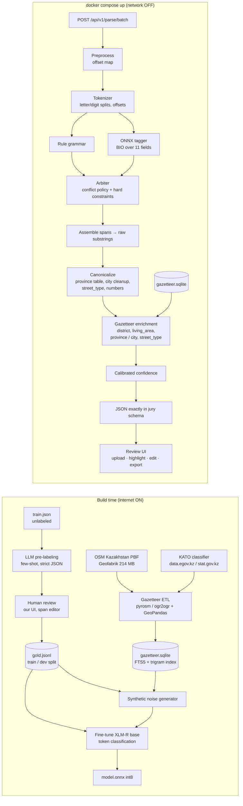

# Jana Address — Winning Architecture
**Terricon Valley × Jana Post Hackathon 2026 · Challenge 01**
*Working doc for the team. Written 2026‑10‑17 from the official brief (20‑slide PDF) and `sample_output.json`.*

---

## 0. TL;DR — the bet

1. **The metric is exact string match per field, after lowercase + punctuation strip. Names are compared "ровно как в строке" — typos and cases are NOT forgiven.** Therefore the parser must *copy spans out of the raw string*, never generate or "fix" text. A generative LLM at runtime is structurally the wrong tool here (it normalizes `казибек би` → `Казыбек би` and loses the point). We build a **span tagger**: every output value is `raw[start:end]`.
2. **`train.json` is unlabeled** (same format as `sample_input.json`). Labels are the scarce resource. We build a **Training‑Data Factory**: LLM pre‑labeling (internet is explicitly allowed during the hackathon) → human verification in *our own* review UI (which is also the required "ручная правка" screen) → synthetic noise generator that mirrors the 9 difficulty bullets in the brief → fine‑tune a small multilingual token classifier (XLM‑R base, ONNX int8) that runs offline on CPU in ~20 ms/record.
3. **Rules + model + gazetteer, arbitrated**, not "either/or". Rules give high precision on `кв/подъезд/этаж/дом` and fractional houses; the model handles the ambiguous (микрорайон‑number vs house, landmarks, Kazakh/Russian splices); the gazetteer validates (street exists in city?) and enriches (`district`, `living_area`, `province`, `street_type`).
4. **Gazetteer = OSM Kazakhstan dump + KATO**, built by us with a house‑level spatial join (street → district even when a street crosses districts), bilingual (`name:kk` / `name:ru`), stored as SQLite inside the image. This is the "engineering" 30%.
5. **Calibrated confidence** (predicts "all four address fields correct"), shown as a reliability curve at the defense, and used in the UI as a *review budget* ("review the lowest 8% → expected 99% accuracy").
6. **Deliverables are first‑class**: own evaluation harness that replicates the jury metric exactly, `docker compose up` tested with network disabled, README with curl examples, architecture diagram, 5‑minute pitch with live metrics.

Realistic target: hidden‑set metric in the 90s on fields that are in the string; everything in the other 55% (engineering/UI/pitch) is fully under our control.

---

## 1. What is actually scored (decoded brief → design consequences)

| Brief says | Consequence for us |
|---|---|
| 45% metrics on a hidden, hand‑labeled set; 30% engineering (справочные поля, сбор справочника, архитектура, код); 15% UI usability; 10% pitch | Metric is <½. Over‑investing in the model alone caps at 45. Gazetteer + review UI + clean repo are 45 points we fully control. |
| Address accuracy 60% = `province`, `city`, `street_name`, `house`; details 25% = `apartment`, `entrance`, `floor`; reference fields 15% = `district`, `living_area` **only where present in the string** | `street_name` and `house` are the money fields. `street_type` is NOT scored automatically (checked at defense). |
| Comparison: lowercase, strip punctuation, collapse spaces, then exact match. "Падежи и опечатки не прощаются — название возвращается в том виде, в каком написано" | Span copy. No normalization of names. `12а` ≠ `12 а` (spaces inside a value matter), `1/2` ≠ `1`. |
| `province`: canonical, "в прямом порядке": «Актюбинская область», «Алматы» for republican cities | The ONE field that is normalized → lookup table of ~20 canonical values with all RU/KZ/abbrev variants. |
| `city`: only the name, no «город», «пос.», no Kazakh half | Strip type words; when `город Актобе/Ақтөбе қаласы` → `Актобе`. |
| `district`: without «район»; `living_area`: микрорайон/ЖК **when the street is given separately** | If the микрорайон *is* the locator (`Мкр Аксай 3а, 59`) → `street_type=микрорайон`, `street_name=Аксай 3а`, `living_area=null`. If `мкр Самал‑2, ул. Жолдасбекова 9` → `living_area=Самал‑2`, `street_type=улица`, `street_name=Жолдасбекова`. Encode this rule explicitly. |
| Field absent in string AND gold → excluded from the count. Absent in string but filled from gazetteer → not in metric, counted by jury at defense | Enrichment can only help. But **never invent** `apartment/entrance/floor/house/street_name` that are not in the string. |
| Every record must get an answer; failures → nulls + low confidence | Hard fallback path; never throw. |
| 5 min / 1000 records; container start ≤ 3 min; **network off during the final run** | CPU inference ≤ 300 ms/record (we'll be ~20 ms). All models/dictionaries inside the image. **No `pip install`/`pull` at run time.** |
| Banned: lookup by record `id`, or returning a stored answer for an exact full‑string match → disqualification | Corrections DB from the UI is for *retraining only*, never consulted at inference. Gazetteer is keyed by street/city, not raw strings. |

**Assumption to confirm with organizers (see §11):** whether "address accuracy" is a per‑field average or per‑record all‑four‑correct. We report both in our harness.

---

## 2. Design principles

1. **Extraction ≠ normalization ≠ enrichment.** Three separate stages with separate tests. Extraction returns offsets; normalization only touches the fields the brief says to normalize; enrichment adds data from the gazetteer with provenance.
2. **Offset‑preserving pipeline.** Invisible characters are removed, Latin lookalikes mapped, case folded — *for matching only*. Every output value is cut from the original string by offsets.
3. **Deterministic first, learned second, verified third.** Rules are the Day‑1 baseline and the Day‑3 validator. The model is the primary tagger once trained. The gazetteer never overrides what the string says; it fills blanks and adjusts confidence.
4. **Every field carries provenance** (`string` / `gazetteer:osm` / `gazetteer:kato` / `inferred`) and a confidence. Shown in the UI, returned in `?explain=1` mode, hidden in the jury schema.
5. **Replicate the jury before the jury does.** `make eval` prints the exact weighted metric on our held‑out, human‑verified dev set after every change.
6. **Boring infrastructure.** One API container + one static web container, SQLite, ONNX Runtime. No Postgres, no Redis, no GPU dependency.

---

## 3. System architecture



### 3.1 Preprocessing (offset‑preserving)
* Strip/replace: `​ ‌ ‍ ⁠ ` (zero‑width), `   ` → space, control chars, `\r\n`. Keep an `orig_index[]` map so every normalized char knows its original offset.
* Build a *matching view*: lowercase, `ё→е`, Latin↔Cyrillic homoglyph fold (`a o c e p x y k m t` → Cyrillic) — used only for dictionaries/gazetteer lookups.
* Output is always `raw[start:end]` from the untouched string (the brief wants `raw_address` echoed unchanged, and values "как в строке").

### 3.2 Tokenizer
Regex tokenizer producing `(text, start, end, kind)` with `kind ∈ {word, number, alnum, punct, slash}`.
Key rule: split at letter/digit boundaries **only for the model's view**, keep the original span: `66квартал` → `66` + `квартал`; `Назарбаева8` → `Назарбаева` + `8`; `4подьезд` → `4` + `подьезд`; `12а` stays one token when the letter run is 1 char and follows digits (house literal), as does `3а` in `Аксай 3а`. Slash tokens are kept (`55/6`, `город Алматы/Алматы қаласы`).

### 3.3 Candidate parsers (run in parallel, ~ms each)

**A. Rule grammar (`rules/`)** — a small cascade:
1. Keyword lexicon (RU/KZ/Latin/abbrev) → roles: `CITY_KW` (город, г., пос., село, аул, қаласы, ауылы, кенті), `DISTRICT_KW` (район, р‑н, ауданы), `STREET_TYPE_KW` (ул, улица, пр, пр‑т, проспект, мкр, м‑н, микрорайон, микроаудан, пер, переулок, кв‑л, квартал, бульвар, б‑р, шоссе, проезд, тупик, көшесі, даңғылы, ulitsa, ul, mkr…), `LIVING_KW` (жк, ж/к, жилой комплекс, ж/м, жилой массив, ТҮК), `HOUSE_KW` (дом, д., д, уй, үй, dom, d.), `APT_KW` (кв, кв., квартира, пәтер, п., kv, flat, apt, ap), `ENTRANCE_KW` (подъезд, подьезд, под., п‑д, кіреберіс, entrance), `FLOOR_KW` (этаж, эт., қабат, floor, fl), `LANDMARK_KW` (магазин, ТЦ, ТРЦ, рынок, школа, остановка, напротив, рядом, возле, ориентир, Qazpost…).
   **Watch‑out:** `кв` = квартира, `кв‑л` = квартал. Resolve by what follows (a number right after `кв` = apartment; a name/number + `дом` later = квартал).
2. Number‑keyword binding both directions: `кв 70`, `70 кв`, `4подьезд`, `подъезд 4`, `9этаж`, `11дом`, `дом 11`.
3. House pattern: `\d+[а-яa-z]?(/\d+[а-яa-z]?)?` with optional `корпус/блок` (kept as separate tokens; see §11 question on корпус).
4. Bilingual splice: `X/X қаласы` → keep left (Russian) half for `city`; general rule: if a `/`‑separated pair where one side ends with a Kazakh type word (қаласы/облысы/ауданы/көшесі), drop the Kazakh side.
5. Positional defaults: first unlabeled name chunk before the house = street name; a leading chunk followed by `,` and matching a city in the gazetteer = city.
Each rule emits `(field, start, end, rule_id, precision_prior)`; precision priors are measured on dev.

**B. Learned tagger (`ml/`)** — token classification, BIO over 11 fields
`PROVINCE, CITY, DISTRICT, LIVING_AREA, STREET_TYPE, STREET_NAME, HOUSE, APARTMENT, ENTRANCE, FLOOR, LANDMARK` (+`O` for keywords, Kazakh duplicates, noise).
* Backbone: `xlm-roberta-base` (278M; covers Kazakh and Russian). Alternatives: `microsoft/mdeberta-v3-base` (often +1–2 F1 on token tasks, slower tokenizer), `cointegrated/rubert-tiny2` (29M, Russian‑only — fast but weak on Kazakh), or a **char‑level BiLSTM‑CRF trained from scratch** (~2M params, trains on CPU in ~20 min, no tokenizer issues — our fallback if no GPU is available).
* Export to ONNX, dynamic int8 quantization → ~280 MB, ~15–25 ms/record on 2 CPU cores, batch of 64.
* Inputs: the model sees the split tokens; we align sub‑word predictions back to tokens (first‑subword rule) and tokens back to original offsets.
* Optional gazetteer features as extra tokens: prefix each token with a tag like `[ST]` if it matches a street in the detected city, `[MK]` if a microdistrict, `[CT]` if a city — cheap +accuracy, do it only if time allows (Day 2 stretch).

**C. libpostal (optional, Day‑2 experiment only).** 20 labels incl. `house_number, road, unit, level, entrance, suburb, city_district, city, state`; 1.8 GB model; Python binding `pypostal`. It lowercases/expands tokens, so it can only be a *feature source* (align its tokens back to our offsets), never the output. Test on 100 train strings in hour 2; keep only if it beats rules on ambiguity cases. Default plan: skip.

### 3.4 Arbiter (`assembly/arbiter.py`)
Per field, inputs: rule spans (with priors), model spans (with token probabilities), gazetteer checks.
Policy (tuned on dev, all thresholds in one YAML):
1. Agree → accept, confidence = high.
2. Only one source has a value → accept it, unless it violates a hard constraint.
3. Conflict → model wins if its span probability ≥ τ_field, else rule wins; **except** `apartment/entrance/floor` with an adjacent explicit keyword, where the rule wins (near‑100% precision patterns).
4. Hard constraints (reject + lower confidence): value must be a substring of raw; `house` must match the house regex; `apartment/entrance/floor` must be `\d+[а-яa-z]?`; spans must not overlap; `street_name` must not consist only of a type keyword; `living_area` and `street_type=микрорайон` are mutually exclusive unless both a микрорайон and a separate street exist.
5. Microdistrict‑number vs house (`Нурсити 2 микрорайон 11дом`): if `street_name + number` exists in the gazetteer as a microdistrict in that city → attach the number to `street_name`; else keep model's decision.

### 3.5 Canonicalization (`assembly/canon.py`)
* `province` → canonical from a table: 17 regions + Астана/Алматы/Шымкент, with variants: `Актюбинская обл`, `Актобе облысы`, `Ақтөбе облысы`, `АКТЮБИНСКАЯ`, `Zhambyl`, `Жетісу/Жетысу/Жетисуская`, `Абай/Абайская`, `Ұлытау/Улытау/Улытауская`, `СКО/ВКО/ЗКО`, old `Нур‑Султан`. **Confirm the exact canonical strings for the 3 new regions with organizers** (official RU form is «область Абай», «область Жетісу», «область Ұлытау», which is *not* "прямой порядок").
* `city` → strip type words and the Kazakh half; keep as written otherwise (do not "fix" `Алмата`). If only the Kazakh name is present (`Ақтөбе қаласы`) → map to RU via KATO (`name_kk → name_ru`) and mark provenance `gazetteer:kato`.
* `district` → strip «район/р‑н/ауданы».
* `street_type` → canonical lemma: улица, проспект, микрорайон, переулок, квартал, бульвар, шоссе, проезд, тупик, жилой массив, площадь, тракт, аллея. Null if not in the string and gazetteer can't tell.
* `apartment/entrance/floor` → digits (+ optional letter) only.
* `house` → the span as written (`55/6`, `12а`, `33/1`).

### 3.6 Gazetteer enrichment (`gazetteer/`)
Only fills **nulls**; never overwrites a value found in the string. Order:
1. Resolve `city` (string → KATO/OSM settlement; fuzzy ≤ 1 edit on the matching view; disambiguate by `province` if present, else by frequency prior from train.json).
2. `province` ← city (KATO hierarchy) if null.
3. If `district` null: lookup `(city, street_name, house)` → district via house points; fallback `(city, street_name)` → district by majority street length; if the street spans several districts and no house hit → fill the majority district with lower confidence and `provenance=gazetteer:osm/ambiguous`.
4. If `street_type=микрорайон` or `living_area` present → district via microdistrict polygon/centroid.
5. If `street_type` null and street resolved → take the gazetteer's type (улица vs проспект) — not scored, but shown at the defense.
6. If `city` null but `district` is a city district (Ауэзовский, Есиль, Аль‑Фарабийский…) → `city` from the district's parent.

### 3.7 Confidence (`confidence/`)
A logistic regression (or isotonic on a score) trained on dev to predict **P(province, city, street_name, house all correct)**. Features: min/mean model probabilities per field, rule/model agreement flags, hard‑constraint violations, gazetteer hit flags (street‑in‑city, microdistrict‑in‑city, house‑point hit), count of leftover unlabeled content tokens, presence of Latin, presence of a slash splice, string length. Report ECE and a reliability diagram. Per‑field confidences are kept internally and shown in the UI.

### 3.8 REST API (FastAPI, `api/`)
* `POST /api/v1/parse/batch` — body: JSON array `[{"id","raw_address"}]` **or** `{"records":[…]}` **or** multipart file. Returns the array in the exact jury schema. Streams in chunks of 64; never fails the whole batch — a bad record returns nulls + `confidence: 0.05`.
* `POST /api/v1/parse` — single record.
* `GET  /api/v1/parse/batch?explain=1` variant / `POST /api/v1/explain` — adds `spans`, `provenance`, `candidates`, `gazetteer_hits` (for UI and defense; never in the default response).
* `GET /health` (ready only after model + gazetteer loaded), `GET /version`, `GET /metrics/dev` (last harness run).
* `POST /api/v1/corrections` — stores UI edits to `corrections.jsonl` (training data only).
* OpenAPI docs at `/docs`. Pydantic schemas = single source of truth, exported to the frontend as TS types.
* CLI parity: `python -m jana_address parse in.json out.json` (fallback if the jury prefers a command).

### 3.9 Review UI (`web/`) — 15% is *usability*, not visual design
React + Vite + TypeScript, TanStack Table, no CSS framework drama (one clean theme). Served by nginx, proxies `/api`.
* Upload `sample_input`‑format JSON (drag & drop) → progress → table.
* **Raw string with colored span highlights** (NER‑style) in every row; hover shows field + confidence + provenance.
* Sort/filter by confidence; "review queue" = lowest‑confidence first; **review budget slider** ("review 8% → expected accuracy X%", from calibration).
* Inline edit of any field; **click‑to‑relabel**: select a span in the raw string, press a hotkey (`S` street, `H` house, `A` apt, `E` entrance, `F` floor, `D` district, `L` living area, `M` landmark) — the value is cut from the string, guaranteeing "как в строке".
* Keyboard‑first: `J/K` next/prev, `Enter` accept, `U` undo, `X` export.
* Right panel "Explain": tokens → rule hits → model probs → gazetteer matches (this is the defense demo).
* Stats bar: fill‑rate per field, confidence histogram, gazetteer coverage per city, dev‑set metric.
* Export corrected JSON (jury schema) + `corrections.jsonl`.
* RU/EN UI strings via a tiny i18n map (nice at the defense, 1 hour of work).

### 3.10 Packaging & offline run
* `docker-compose.yml`: `api` (python:3.11‑slim, onnxruntime, tokenizers, fastapi, sqlite) and `web` (nginx:alpine serving the Vite build). Startup < 30 s.
* Model, `gazetteer.sqlite`, dictionaries baked into the `api` image at build time (multi‑stage; build stage downloads nothing at run time).
* **Trap:** "network off during the final run" also kills `docker compose up --build` (base image pulls, `pip install`). Ship **both**: (a) `make images` → `jana-address-images.tar` (`docker save`) + `docker load` instructions; (b) buildable Dockerfiles. Ask organizers which they will use (§11).
* **Trap:** jury laptop may be Apple Silicon → build `linux/amd64` and `linux/arm64` with `buildx` (onnxruntime/tokenizers have arm64 wheels). Test both.
* Offline rehearsal: `docker network create --internal nonet` and run compose with `network_mode` on it, or simply `docker run --network none`.
* Resource test: 1000 records on 2 vCPU / 4 GB must finish < 60 s; log it in README.

---

## 4. Gazetteer: sources, ETL, schema, matching

### 4.1 Sources (verified 2026‑10‑17)
| Source | What we take | Notes |
|---|---|---|
| **OpenStreetMap, Kazakhstan extract** — [Geofabrik page](https://download.geofabrik.de/asia/kazakhstan.html) | Admin boundaries (oblasts, districts, **city districts**), `place=*` (city/town/village/suburb/neighbourhood/quarter = микрорайоны, жилые массивы), `highway=*` with names, buildings/points with `addr:street`, `addr:housenumber`, `addr:place`, `addr:suburb`, `addr:district`, `addr:city`, named `landuse=residential`, `name` of ЖК (residential complexes) | `kazakhstan-latest.osm.pbf` = **214 MB**; no sub‑regions. **KZ OSM convention: `name` = Kazakh (migration in progress, so many objects still carry Russian there), `name:ru` = Russian, `name:kk` = Kazakh** ([WikiProject Kazakhstan](https://wiki.openstreetmap.org/wiki/WikiProject_Kazakhstan)) — always extract `name`, `name:ru`, `name:kk` and match against all three. |
| **KATO** (Классификатор административно‑территориальных объектов) — [data.egov.kz `kato`](https://data.egov.kz/datasets/view?index=kato) (МНЭ, Excel/JSON, archived but downloadable, updated 18.09.2026); [data.egov.kz `akimshilik-aumaktyk_obektiler`](https://data.egov.kz/datasets/view?index=akimshilik-aumaktyk_obektiler) (МФ/ЭФЦ, Excel/JSON, versions v1–v4, updated 06.02.2026, API needs a key); [stat.gov.kz classifiers](https://stat.gov.kz/ru/classifiers/statistical/21/) | Official hierarchy oblast → district / city → settlement with **RU and KZ names**, codes; includes city districts of Алматы/Астана/Шымкент/Караганда… | Our source of truth for `province` canonical names, `city` RU↔KZ mapping, district→city parent. Download the xlsx in hour 1; check whether the file has city districts (it should), otherwise take them from OSM. |
| **train.json itself** | Frequency priors: which cities/streets/microdistricts actually occur; typo variants of keywords; templates for the synthetic generator | Never used as a raw‑string lookup at inference. |
| Public geocoders ([Nominatim public instance](https://operations.osmfoundation.org/policies/nominatim/): max 1 req/s, no bulk; Yandex/2GIS APIs) | Only to *audit* our gazetteer during development (spot‑check 200 street→district pairs) | Usage policies limit bulk use and storing results; OSM self‑extraction is cleaner and fully offline. |
| LLM (Claude/GPT) | Fill gaps: list of ЖК per city not in OSM, abbreviation variants, Kazakh/Russian street‑name pairs; **every LLM‑proposed entry must be verified against OSM/KATO or marked `source=llm, unverified`** | Hallucination risk → verification mandatory. |

### 4.2 ETL (`data_pipeline/`, runs once, ~1–2 h wall time incl. download)
```
make gazetteer
  1. download kazakhstan-latest.osm.pbf (214 MB)
  2. osmium tags-filter → boundaries, places, highways, addr:*  (shrinks to ~60 MB)
  3. pyrosm / ogr2ogr(osmconf.ini with addr:* enabled) → GeoDataFrames
  4. build polygons: oblasts, districts, city districts, city limits, microdistricts (polygons where mapped, else 400 m buffers around place nodes)
  5. streets: merge ways by (city, name:ru) → multilinestring; spatial join with city-district polygons → district shares
  6. house points: addr:housenumber points/centroids → (city, street, house) → district
  7. KATO xlsx → tables kato_unit(code, level, name_ru, name_kk, parent)
  8. aliases: abbreviations, RU↔KZ pairs, historical names (Нур-Султан↔Астана, Фурманова↔Назарбаева…), transliterations
  9. write gazetteer.sqlite (+ FTS5 trigram for fuzzy) ; print coverage report per city
```
Robustness notes: OSM admin_level for Kazakhstan city districts is not settled in the community ([discussion](https://community.openstreetmap.org/t/topic/53133)) → **select city‑district relations by geometry (inside the city polygon) and `name:ru` ending in «район», not by a hardcoded admin_level**. `pyrosm` custom filters: [`get_data_by_custom_criteria(custom_filter={"addr:street": True}, tags_as_columns=[...])`](https://pyrosm.readthedocs.io/en/stable/custom_filter.html).

### 4.3 Schema (SQLite)
```
province(id, name_ru_canonical, name_kk, kato_code, aliases json)
settlement(id, province_id, name_ru, name_kk, type, kato_code, lat, lon, aliases json)
city_district(id, settlement_id, name_ru, name_kk, geom_wkb, kato_code)
microdistrict(id, settlement_id, name_ru, name_kk, kind ∈ {микрорайон, жилой массив, ЖК, квартал}, district_id, geom_wkb)
street(id, settlement_id, name_ru, name_kk, type_ru, aliases json, geom_wkb)
street_district(street_id, district_id, share_of_length)
house(street_id, housenumber_norm, district_id, lat, lon)
alias(kind, alias_norm, target_id, source)      -- abbreviations, RU/KZ, old names
```
Matching keys are stored in the *matching view* (lowercase, ё→е, homoglyphs folded, punctuation stripped). Fuzzy: FTS5 trigram + `rapidfuzz` re‑rank, threshold tuned on dev; never alter the output value — fuzzy match only drives enrichment and confidence.

### 4.4 What the jury wants to hear about it (engineering 30%)
"Source → how prepared → how matched → coverage numbers → failure modes." Have one slide: *N cities, N streets, N microdistricts, N house points; district fill‑rate on dev = X%; ambiguity rate = Y%; provenance per field.*

---

## 5. Training‑Data Factory

### 5.1 Why
`train.json` has no labels. The hidden set is hand‑labeled by Jana Post people following the slide‑8 rules. Our labels must follow the same conventions, and we need enough of them (target ≥ 2 000 human‑verified records, 1 500 minimum, + 30–50k synthetic).

### 5.2 Pipeline
1. **Conventions sheet** (hour 1): one page of decisions per field, derived from slides 7–8 and `sample_output.json`, with 30 hand‑made examples. Everyone labels by it. (Ask organizers the open questions in §11 early.)
2. **LLM pre‑labeling** (hours 2–8): prompt with the conventions sheet + 30 examples, strict JSON, "copy values verbatim from the string". Batch 20 records per call; ~5k records ≈ 2–3M tokens → cheap. **Validators:** each value must occur in the raw (case‑insensitive, whitespace‑tolerant); numbers must match patterns; no overlapping spans; `living_area` xor `street_type=микрорайон` rule. Failures → review queue.
   *Caveat:* the brief says issued data must not leave the hackathon. Using LLM APIs for base preparation is explicitly allowed, but **ask the organizers** whether sending train strings to an external API is fine; if not, run a local model (Qwen2.5‑14B/32B on a GPU box) or label by hand with rules pre‑filling.
3. **Human verification in our UI** (hours 6–20, in parallel): rules and LLM pre‑fill; the reviewer sees disagreements highlighted; ~8–10 s/record with hotkeys → 1 000 records ≈ 2.5 h of one person. Prioritize: all LLM/rule disagreements, all validator failures, then a random sample.
4. **Split:** stratify by city; **dev = 600–800 verified real records, frozen, never trained on**; test = another 300 for the final sanity run. Report the jury metric on dev after each change.
5. **Synthetic generator** (`training/synth.py`): mine templates from verified records (replace spans with slots), fill slots from the gazetteer (streets of a random city, microdistricts, fractional/lettered houses, apt/entrance/floor), then apply noise operators mirroring slide 9: glue number+keyword (`11дом`, `4подьезд`), abbreviation swaps (`ул.`/`ул`/`улица`/`ulitsa`/`көшесі`), Kazakh duplicate insertion (`город X/X қаласы`), city duplication, district‑instead‑of‑city, typos (`подьезд`, `Ул .Курильская`), Latin (`kv 12`, `flat 191`, `dom`), invisible chars (`​`, ` `), random case, landmarks (`магазин Береке`, `Qazpost Солнечный`). Mix real:synthetic ≈ 1:5 with real up‑weighted ×3. **Validate only on real.**
6. **Train** (`training/train.py`): `xlm-roberta-base`, max_len 64, lr 3e‑5, 4–6 epochs, label smoothing 0.05, early stop on dev span‑F1. GPU (Colab/Kaggle T4 is enough, ~15 min). Export ONNX + int8; assert ONNX == PyTorch predictions on dev.
7. **Error analysis loop** (`make errors`): confusion by field, top‑30 misses with raw strings → fix rules/conventions/synthetic operators → retrain. Budget 3 loops.
8. **Closing the loop at the defense:** show that a reviewer's corrections in the UI become training data (`corrections.jsonl → make retrain`). Human‑in‑the‑loop is the product story Jana Post needs for ongoing operation.

### 5.3 Evaluation harness (`eval/metric.py`) — replicate the jury exactly
```python
import re
PUNCT = re.compile(r"[^\w\s]", re.UNICODE)      # strip punctuation
WS    = re.compile(r"\s+")

def norm(v):
    if v is None: return None
    v = PUNCT.sub("", str(v).lower())
    return WS.sub(" ", v).strip()

# Fields the gazetteer may fill: if gold is null (not in the string) the jury does
# not count them ("подняло из справочника — в метрику не входит").
ENRICHABLE = {"province", "city", "district", "living_area"}

def field_acc(preds, golds, field, strict=True):
    hit = tot = 0
    for p, g in zip(preds, golds):
        pv, gv = norm(p.get(field)), norm(g.get(field))
        if gv is None and (pv is None or field in ENRICHABLE or not strict):
            continue                        # not in the string → excluded
        tot += 1; hit += (pv == gv)         # gold present & pred null → error
    return hit / tot if tot else 1.0

ADDRESS = ["province", "city", "street_name", "house"]
DETAILS = ["apartment", "entrance", "floor"]
REFS    = ["district", "living_area"]       # gold has them only when in the string

def score(preds, golds, strict=True):
    f = lambda fs: sum(field_acc(preds, golds, x, strict) for x in fs) / len(fs)
    a, d, r = f(ADDRESS), f(DETAILS), f(REFS)
    return 0.60 * a + 0.25 * d + 0.15 * r, dict(address=a, details=d, refs=r)
```
`strict=True` is our pessimistic default: a hallucinated `apartment/floor/house/street_name` (gold null, pred non‑null) counts as an error. Also compute the per‑record "all four address fields correct" variant and per‑field accuracy; both go on the UI stats bar and the pitch.

---

## 6. Field conventions (decision table — keep in `docs/CONVENTIONS.md`, confirm open items with organizers)

| Field | Rule we implement | Examples |
|---|---|---|
| `province` | Canonical table; «Алматы/Астана/Шымкент» for republican cities; from string if present else from gazetteer (provenance) | `Актюбинская обл.` → `Актюбинская область`; `город Алматы/Алматы қаласы` → `Алматы` |
| `city` | Name only, RU half, type words removed, otherwise as written; if only district of a city is given → city from gazetteer | `город Актобе/Ақтөбе қаласы` → `Актобе`; `пос. Боралдай` → `Боралдай` |
| `district` | As written minus «район/р‑н/ауданы»; oblast districts and city districts both go here; else from gazetteer | `Турксибский район` → `Турксибский`; `Илийский р-н` → `Илийский` |
| `living_area` | Микрорайон/ЖК/жилой массив **when a separate street exists**; name without «мкр/ЖК» | `мкр Самал-2, ул. Жолдасбекова 9` → `Самал-2`; `Пришахтинск, ул. Ленина 5` → `Пришахтинск` |
| `street_type` | Canonical lemma; null if absent and unknown | `Мкр` → `микрорайон`; `пр-т` → `проспект` |
| `street_name` | Exact span, no type word, case/typos untouched; microdistrict number stays in the name | `Мкр Аксай 3а` → `Аксай 3а`; `казибек би` → `казибек би`; `Нурсити 2 микрорайон` → `Нурсити 2` |
| `house` | Exact span with fraction/letter | `55/6`, `12а`, `33/1`; (`корпус` — see §11) |
| `apartment/entrance/floor` | Number only (+ letter if written) | `кв 70` → `70`; `4подьезд` → `4`; `flat 191` → `191` |
| `landmark` | Span as written incl. the object word | `магазин береке`, `Qazpost Солнечный` |
| `confidence` | P(address fields all correct), calibrated | — |

---

## 7. Creative differentiators (what the jury will remember)

1. **"Копируем, не придумываем"** — the span‑copy architecture is the direct answer to their metric; say it in one sentence with the `казибек би` example.
2. **Training‑Data Factory + human‑in‑the‑loop** — the required correction screen *is* the labeling tool; corrections → retraining. Show the loop live: correct 3 records → "retrain scheduled" → dataset grew by 3.
3. **House‑level district resolution** — streets like проспект Абая cross three Almaty districts; we resolve by house point, not by street name. One map slide.
4. **Bilingual gazetteer** — `name:kk ↔ name:ru` pairs from OSM + KATO; `Ақтөбе қаласы` alone still yields `Актобе`.
5. **Calibrated confidence with a review budget** — "review 8% of records to reach 99%" is an operational promise for Jana Post's couriers and analysts, not a number in a JSON.
6. **Explain mode** — a debugger view per record: tokens, rule hits, model probabilities, gazetteer evidence, provenance. Judges can type any address during Q&A.
7. **Exact jury metric in the repo** — `make eval` and a live dev‑set score in the UI. Invites the jury to trust our numbers.
8. **Synthetic noise operators named after their slide‑9 bullets** — shows we read the brief and engineered against each listed difficulty.

---

## 7a. Team Q&A (normalization, LightGBM, own model vs API, GPU)

**Normalization — two different things, kept apart in code.**
*Matching normalization* (`preprocess.match_view`): lowercase, `ё→е`, Latin lookalikes → Cyrillic, dots removed, zero‑width chars killed, abbreviation expansion through the lexicon. Used only to recognize keywords and hit the gazetteer. *Output normalization* (`assembly/canon.py`): only `province` (canonical table), `city`/`district` (type words stripped), `street_type` (lemma), numbers (digits). Everything else is `raw[start:end]` — the offset‑preserving `clean()` guarantees the two strings have identical indices.

**LightGBM — yes, for tabular decisions, not for tagging.** (1) `confidence/`: features = parser flags, model span probabilities, rule/model agreement, gazetteer hits, leftover tokens → P(all four address fields correct), isotonic‑calibrated. (2) Optionally the arbiter: a per‑field classifier choosing between the rule candidate and the model candidate. Sequence tagging (which token is street vs house) needs context over the whole string — transformer / CRF territory. A `sklearn-crfsuite` CRF with gazetteer features is a legitimate CPU‑only alternative to XLM‑R if the GPU falls through.

**Own model vs AI API — both, in different phases, not a choice.** Final run is offline → the tagger must ship inside the image. The API's only job is labeling `train.json` (and generating hard synthetic cases). With a university GPU you can label fully locally (Qwen2.5‑32B‑Instruct on vLLM, ≥ 48 GB; 14B on 24 GB) — no data leaves the hackathon, which answers organizer question Q10 by construction. `training/label_llm.py` supports both (`--provider anthropic | openai-compatible | rules`).

**GPU needs.** Fine‑tune `xlm-roberta-base` (278M): any 16 GB card, 20–30 min for ~40k sequences × 5 epochs. Local labeling LLM: see above. Inference never needs a GPU (ONNX int8 on CPU, ~20 ms/record).

**Status (2026‑10‑17, evening):** the skeleton runs end‑to‑end — rule grammar v1 passes all 42 convention examples (incl. Kazakh word order, «ықшам аудан», ordinals «11‑ші»), API in exact jury schema accepting file upload or JSON, review UI with span highlights and hotkeys, jury‑metric replica, labeling pipeline with validators, dataset builder + synthetic generator + train/export/calibrate scripts, ONNX tagger runtime + arbiter wired (activates when `api/artifacts/model.onnx` exists), Docker compose. 100 tests. Team decisions (file upload, `12/2` for корпус, KK→RU city, both metric readings) are logged in `docs/CONVENTIONS.md` with the switch that implements each; work split in `docs/HANDOFF.md`.

**Decisions that changed the design since the first draft:** the jury will upload a file → one endpoint accepts multipart *and* JSON; «12 корпус 2» → `12/2` (team decision, behind `conventions.yaml: house_building_join`); Kazakh-spelled cities map to Russian; `living_area` stays «Томирис» (brief example) despite the team's "with ЖК" preference — one switch flips it if the organizers disagree.

## 8. 56‑hour plan — two people (Kassymzhomart: ML/data/backend · Yasmin: repo lead + frontend)

| Hours | Kassymzhomart | Yasmin |
|---|---|---|
| 0–2 | Read train.json; fix conventions with real strings (update `data/conventions_examples.json`); send Q1–Q10 to organizers | Repo hygiene (branches, CI running `make test`), UI smoke on real data, collect UX pain points |
| 2–8 | Download OSM PBF + KATO; tag inventory; gazetteer ETL v1 → `gazetteer.sqlite` (cities, districts, microdistricts, streets) | UI: review queue polish, keyboard flow, "needs_review" import from `labels_*.jsonl`, stats bar |
| 8–20 | LLM/local pre‑labeling of all train strings; both review ~600 records each in the UI; rule fixes from errors; dev set frozen (600–800) | Review sprint; UI fixes found while reviewing; export/import of corrections → `train_gold.json` |
| 20–32 | Synthetic generator; fine‑tune XLM‑R on GPU; ONNX export; arbiter + `make eval` loop ×2 | Explain panel v2 (gazetteer evidence), i18n RU/EN, README screenshots, Dockerfiles verified on arm64 |
| 32–44 | House‑level district join; confidence calibration (LightGBM + isotonic); error loop ×3; freeze model | `docker save` tarball, offline rehearsal, 1000‑record timing, pitch deck draft (10 slides) |
| 44–52 | **Code freeze.** Final held‑out run; crash fixes only | Demo script, Q&A drill with live addresses, deck final |
| 52–56 | Buffer; rebuild images; clean‑machine test; submit | Buffer |

Rule of thumb for two people: anything not on this table is cut. libpostal, a map view and a second ML backbone are the first to go.

## 8b. 56‑hour plan (3–4 people; original version)

| Hours | Track A — Parsing & ML | Track B — Gazetteer & Data | Track C — API, UI, Infra |
|---|---|---|---|
| 0–2 | Read train.json; write `CONVENTIONS.md`; 30 hand examples; metric harness; tokenizer + preprocess | Download PBF + KATO; inspect tag distributions (`addr:*`, `place`, boundaries) | Repo skeleton, FastAPI stub returning nulls, compose up works, CI lint/test |
| 2–8 | Rule grammar v1 → ≥ 70% on hand examples; LLM pre‑labeling scripts + validators | ETL: boundaries, places, streets, house points → `gazetteer.sqlite` v1 + coverage report | UI v1: upload, table, span highlights (from `explain`), inline edit |
| 8–20 | Human verification sprint (everyone, 1–2 h each) → ≥ 1 500 verified; synthetic generator; **first XLM‑R fine‑tune**; dev score | Aliases (abbrev, RU/KZ, old names); enrichment functions; audit 200 pairs vs Nominatim | Review queue, hotkeys, confidence filter, export; `/explain`; corrections endpoint |
| 20–32 | Arbiter policy tuned on dev; error loop ×2; ONNX export + int8; speed test | Microdistrict polygons/buffers; street‑district shares; house‑level lookup; fallbacks | Stats bar; explain panel; i18n; README draft; `docker save` path; arm64 build |
| 32–44 | Confidence calibration (LR/isotonic), reliability plot; error loop ×3; freeze model | Gazetteer coverage report → slide; failure modes list | Offline rehearsal (`--network none`), 1000‑record timing on 2 vCPU; README final; architecture diagram |
| 44–52 | **Code freeze.** Final test on held‑out 300; fix only crashes | — | Pitch deck (10 slides), demo script, Q&A drill (type live addresses) |
| 52–56 | Buffer: rebuild images, verify `docker load` + `compose up` on a clean machine, submit |  |  |

Role suggestion: **A** = strongest ML/Python; **B** = geo/data person (GeoPandas, SQL); **C** = frontend + DevOps; the 4th rotates between labeling and pitch.

---

## 9. Risks & mitigations

| Risk | Mitigation |
|---|---|
| Label‑convention mismatch with the hidden set (the biggest risk to the 45%) | Conventions sheet from slides 7–8 + sample; ask organizers §11 questions on day 0; keep the arbiter rules in YAML to flip conventions in minutes |
| No GPU for fine‑tuning | Colab/Kaggle T4; fallback char BiLSTM‑CRF trains on CPU; rules‑only still submits |
| Offline run breaks (pulls, pip, model download at start) | Everything baked at build; HF offline env vars; `docker save` tarball; rehearsal with `--network none` |
| Apple Silicon / different CPU on jury machine | `buildx` amd64+arm64; onnxruntime everywhere; no CUDA |
| Speed | ONNX int8, batch 64, 2 threads → ~20 ms/record; hard timeout per record with null fallback |
| Disqualification trap | No raw‑string → answer lookup anywhere in the request path; corrections used only in training; code review before freeze |
| Kazakh‑only strings | `name:kk` in gazetteer, Kazakh keyword lexicon, KZ synthetic operators |
| Hallucinated gazetteer entries from LLM | Verify against OSM/KATO; `source` column; unverified entries never used for scoring fields |
| Time sink on libpostal / Nominatim self‑hosting | Hard 2‑hour experiment cap; default is skip |
| Accepting a non‑array request body format from the jury | Endpoint accepts array, `{records}`, and multipart; documented curl examples; CLI fallback |

---

## 10. Stack & repo layout

**Backend:** Python 3.11, FastAPI, Pydantic v2, onnxruntime, `tokenizers`, `rapidfuzz`, SQLite (+FTS5), `regex`. **Training (not shipped):** PyTorch, `transformers`, `datasets`, `seqeval`, `scikit-learn`. **Geo ETL (not shipped):** `osmium-tool`, `pyrosm`/GDAL `ogr2ogr`, GeoPandas, Shapely. **Frontend:** React 18 + Vite + TypeScript, TanStack Table/Query. **Infra:** Docker multi‑stage, compose (api + nginx), `make` targets, GitHub Actions (lint, tests, build).

```
jana-address/
├─ api/
│  ├─ jana_address/
│  │  ├─ preprocess.py        # offset-preserving cleanup, matching view
│  │  ├─ tokenizer.py
│  │  ├─ rules/               # lexicon.yaml, grammar.py
│  │  ├─ ml/                  # onnx_tagger.py, alignment.py
│  │  ├─ assembly/            # arbiter.py, canon.py, policy.yaml
│  │  ├─ gazetteer/           # db.py, match.py, enrich.py
│  │  ├─ confidence/          # calibrator.pkl, features.py
│  │  ├─ schemas.py           # jury schema + explain schema
│  │  ├─ service.py           # parse_one / parse_batch
│  │  └─ main.py              # FastAPI app
│  ├─ artifacts/              # model.onnx, tokenizer.json, gazetteer.sqlite, province.yaml
│  ├─ tests/                  # golden tests from CONVENTIONS examples, property tests (value ⊂ raw)
│  └─ Dockerfile
├─ web/                        # Vite app, Dockerfile (nginx)
├─ data_pipeline/              # make gazetteer: download → filter → build → sqlite → report
├─ training/                   # label_llm.py, validate_labels.py, synth.py, train.py, export_onnx.py, calibrate.py
├─ eval/                       # metric.py (jury replica), errors.py
├─ docs/                       # CONVENTIONS.md, ARCHITECTURE.md (this), gazetteer_report.md, pitch/
├─ docker-compose.yml
├─ Makefile                    # up, eval, gazetteer, train, images, offline-test
└─ README.md                   # run in 3 commands, API examples, test accounts n/a, what is real vs mocked
```

**Should we use AI APIs?** Yes — at build time (labeling, synthetic hard cases, gazetteer gap‑filling, code). No — at run time (offline rule; a CPU LLM at 5–10 s/record cannot meet 1000 records / 5 min and would normalize text). Mention this trade‑off explicitly at the defense; it signals judgment.

---

## 11. Open questions — for organizers (ask on day 0)

1. Exact way the jury calls the API: path, method, body shape (bare array vs wrapper), file upload? Or do they follow our README?
2. Jury machine: CPU/RAM, GPU or not, Docker version, **amd64 or Apple Silicon**? Will they run `docker compose up --build` online beforehand, or do they want a `docker load` tarball?
3. "Точность адреса": per‑field average or per‑record all‑four‑correct?
4. Canonical `province` strings for the three 2022 regions (область Абай / Жетісу / Ұлытау vs «Абайская область»…), and for old «Нур‑Султан» strings.
5. `street_name` for numbered microdistricts: `11 микрорайон, 5 дом` → `street_name = "11"`? `Аксай 3а` confirmed by the sample.
6. `living_area` for `ЖК`: with or without the word «ЖК»? (`Томирис` in the brief suggests without.)
7. `house` with `корпус/блок/строение` (`12 корпус 2`, `12 блок А`) — keep `12` only, or `12/2`?
8. Are extra keys in the response tolerated (for explainability) or must the schema be exact? (We default to exact.)
9. May we send `train.json` strings to an external LLM API for pre‑labeling, given "данные не выносятся за пределы хакатона"?
10. Hidden‑set size and the expected share of Kazakh‑only strings.

## 12. What I need from you

* Team size, each person's strongest stack, and GPU access (local or Colab).
* Hackathon dates/hours and whether `train.json` is already in hand (if yes — send 50 random lines so I can write the rule grammar and conventions sheet against real data).
* Preferred frontend (React assumed) and whether anyone has GeoPandas experience.
* Permission to draft: `CONVENTIONS.md`, the LLM labeling prompt + validators, `eval/metric.py`, the rule lexicon YAML, and the FastAPI/Compose skeleton — I can produce all five next.

---

## Sources
* Official brief: `Jana_Post_Terricon_Hackathon_2026 1.pdf` (slides 4–11) and `sample_output (1).json` in `janapost/`.
* Geofabrik Kazakhstan extract (214 MB PBF, no sub‑regions): https://download.geofabrik.de/asia/kazakhstan.html
* OSM WikiProject Kazakhstan — `name` = Kazakh, `name:ru` = Russian: https://wiki.openstreetmap.org/wiki/WikiProject_Kazakhstan
* OSM community thread on Kazakhstan admin boundaries (admin_level for city districts unsettled): https://community.openstreetmap.org/t/topic/53133
* KATO on data.egov.kz (МНЭ, Excel/JSON): https://data.egov.kz/datasets/view?index=kato ; MinFin classifier (Excel/JSON, v1–v4, API with key): https://data.egov.kz/datasets/view?index=akimshilik-aumaktyk_obektiler ; stat.gov.kz classifiers: https://stat.gov.kz/ru/classifiers/statistical/21/
* Unified open‑data list incl. «Административно‑территориальные единицы РК» (Бюро национальной статистики): https://zakon.uchet.kz/rus/docs/V2300032813
* Nominatim usage policy (public instance): https://operations.osmfoundation.org/policies/nominatim/
* pyrosm custom tag filters: https://pyrosm.readthedocs.io/en/stable/custom_filter.html
* libpostal (20 labels, 1.8 GB model, pypostal binding): https://github.com/openvenues/libpostal ; design notes: https://mapzen.com/blog/inside-libpostal
* XLM‑R (100 languages incl. Kazakh): Conneau et al., 2019, https://arxiv.org/abs/1911.02116

**Hypotheses this plan rests on:** (1) the hidden set follows slide‑8 conventions and `sample_output.json`; (2) the jury runs on CPU; (3) `train.json` is representative of the hidden set's city mix; (4) OSM coverage of streets/house numbers in Almaty, Astana, Shymkent and regional centres is good enough for district enrichment (audit in hour 3 — if it is weak for a city, KATO still gives province/city and we degrade gracefully to street‑level or null with low confidence).
